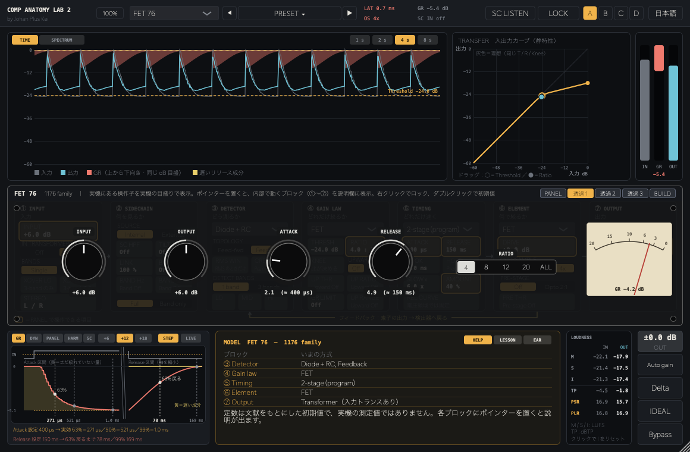
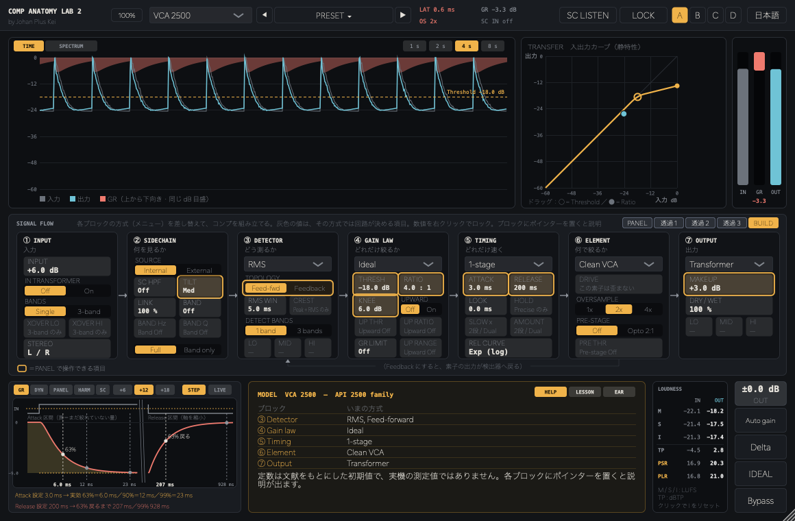
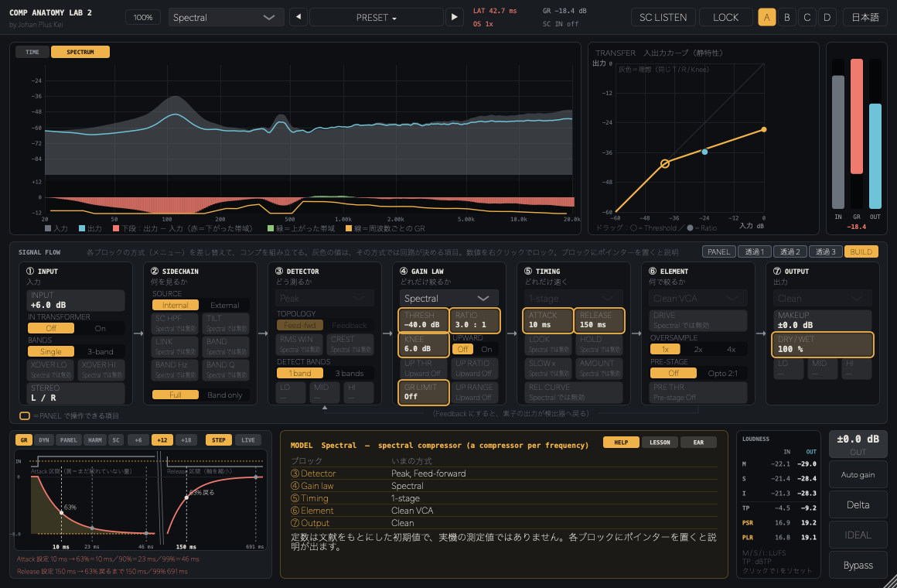
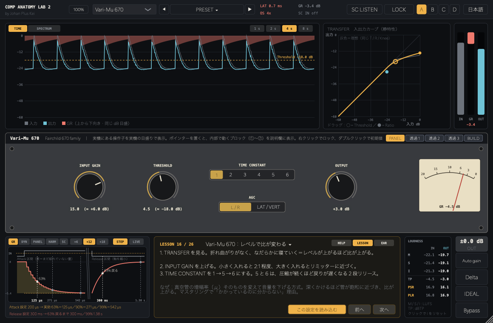

# Compressor Anatomy Lab 2 β（JUCE プラグイン）

by Johan Plus Kei — コンプの中身を「組み立てて・見て・聴いて」学べる VST・AU 対応プラグイン（VST3 / AU / Standalone）。1 台で 21 機種のコンプを、7 つのブロックの組み合わせとして再現します。



## ⬇️ ダウンロード（ベータ版）/ Download (Beta)

**[最新版をダウンロード / Download latest](https://github.com/kazufumi01/CompAnatomyLab2/releases/latest)** — 無料配布中 / Free

| | 手動インストール（おすすめ） | インストーラー |
|---|---|---|
| **Mac**（macOS 11+, Apple Silicon / Intel） | `CompAnatomyLab2-0.2.0-mac.zip` | `CompAnatomyLab2-0.2.0-mac.pkg` |
| **Windows**（10 / 11, 64bit）⚠️未検証 | `CompAnatomyLab2-0.2.0-win64.zip` | `CompAnatomyLab2-0.2.0-win64.exe` |

- 紹介記事（日本語）：**[1台で21機種のコンプを組み立てて学ぶ](https://jpk.seesaa.net/article/522006512.html)**
- インストール方法：**[INSTALL.md](INSTALL.md)**（日本語 / English）
- ⚠️ **Windows 版は実機での動作確認ができていません**（自動ビルドで作成。VST3 と Standalone）。 / The Windows build is untested on real hardware.
- Apple の公証・Windows のコード署名をしていないため、初回のみ警告が出ます。
- 不具合・要望は [Issues](https://github.com/kazufumi01/CompAnatomyLab2/issues) へ。

---

## 主な機能

- **7 つのブロックでコンプを組み立てる（BUILD）**：① INPUT ② SIDECHAIN ③ DETECTOR ④ GAIN LAW ⑤ TIMING ⑥ ELEMENT ⑦ OUTPUT の「方式」を差し替える
  - 検出：Peak / RMS / Diode+RC / Peak+RMS、フィードフォワード / フィードバック
  - ゲインカーブ：Ideal / FET / Opto / Vari-Mu / Diode / Limiter / Rider / Spectral / Clipper、Upward、GR Limit
  - タイミング：1 段 / 2 段（プログラム依存）/ 光学セル / Auto / Precise（先読み）/ Dual average、リリースカーブ、Look-behind
  - 素子と出力段：Clean / FET / Tube / Opto / Diode、トランス（Nickel / Iron / Steel）、倍音、オーバーサンプリング 1x / 2x / 4x、直列 2 段
- **21 の MODEL**：FET 76、Opto 2A / 3A、Vari-Mu 670、Bus VCA G、VCA 160 / 2500、Channel VCA E、Diode 254、EL 8、Tube Opto 1B、Digital DS-1、Dual Opto + VCA、Limiter、Clipper、Spectral、Upward、OTT 3-Band、Rider など（実機名は参考にした系統。定数は文献ベースの初期値）
- **PANEL**：その機種の実機にある操作子だけを、実機の目盛りと配色で表示。透過して下の BUILD と見比べられ、BUILD 側では PANEL が動かす項目を強調
- **表示**：TIME（入出力レベルと GR）、SPECTRUM（周波数ごとの増減）、TRANSFER（静特性、ドラッグで操作）、GR WAVE（Attack / Release の定義）、DYNAMICS（PEAK / RMS / CREST / RANGE）、HARMONICS（倍音と折り返し）、SC FILTER（検出器が聴く音）、LOUDNESS（M / S / I、トゥルーピーク、PSR / PLR）
- **IDEAL 比較**：同じくらいの GR 量のクセのないコンプに切り替えて、機種の「クセ」だけを聴く
- **LESSON 26 本**（設定の読み込み付き）と **EAR（耳トレ）**：Attack / Release / Ratio / 機種当て
- **プリセット 62 本**（機種別・用途別）とユーザープリセット、◀ ▶ で順送り。A / B / C / D スロット、パラメーターロック
- 停止中も最後に鳴った音を今の設定で再計算して表示、Auto gain、Delta（差分）試聴
- ↑↓ キーで値を 1 段ずつ（Shift で細かく）、配色 14 種、日本語 / English







---

## ビルド

```bash
./build.sh            # 手元の JUCE（~/Documents/jpkplugins/JUCE）を使う。無ければ CMake が JUCE 9.0.4 を取得
```

- Windows は GitHub Actions（`.github/workflows/build-win.yml`、手動実行）で VST3 / Standalone をビルドし、Inno Setup でインストーラーを作成
- Mac のインストーラー作成：`packaging/mac/build_pkg.sh [version]` ／ `packaging/mac/build_zip.sh [version]`（出力は `dist/`）

## ライセンス

JUCE は **Starter ライセンス** で使用。配布物はフリーウェア使用許諾（`packaging/mac/resources/license.txt`）に従います。
ソースは学習目的で公開していますが、無断での再配布・販売はできません。

---

**Johan Plus Kei** — [Spotify](https://open.spotify.com/artist/30PV2gqUbDDwvuWtKaok0x) ・ [Apple Music](https://music.apple.com/us/artist/johan-plus-kei/519360150) ・ [X](https://x.com/johanpluskei) ・ [Instagram](https://www.instagram.com/johanpluskei) ・ [Learning labs](https://kazufumi01.github.io/)

## Support / 支援

Compressor Anatomy Lab 2 is free. If it helps your mixing or your classes, you can support development with a one-time tip via [PayPal](https://paypal.me/johanpluskei). More ways to help: <https://kazufumi01.github.io/support/>

Compressor Anatomy Lab 2 は無料です。ミックスや授業で役立ったら、[PayPal](https://paypal.me/johanpluskei) からの投げ銭で開発を支えていただけるとうれしいです。
